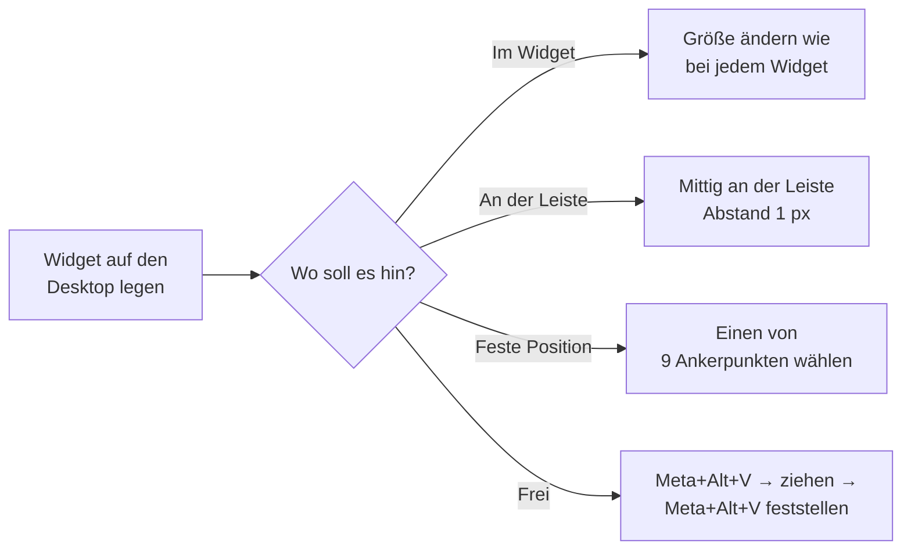

<div align="center">


<br>

[](https://kde.org/de/plasma-desktop/)
[](CHANGELOG.md)
[](LICENSE)
[](#-sprachen)

**Ein schöner Audio-Visualizer für deinen KDE-Plasma-6-Desktop –<br>19 Stile, fließende macOS-Farben und eine Kugel (oder eine drehende Schallplatte), die Musik und Videos pausiert.**

[English](README.md) · **Deutsch**

<br>


<sub>🎬 Das ganze Demo-Video mit allen Stilen: <a href="docs/soundwave-demo.mp4"><b>soundwave-demo.mp4</b></a></sub>

</div>

---

## 🆕 Neu in 2.5 – die Schallplatte

<table>
<tr>
<td width="46%"></td>
<td>

### 💿 Ein Plattenspieler mitten auf dem Desktop

- **Dreht sich mit der Musik** – 33 U/min, solange etwas läuft, und hält bei Pause genau dort an
- **Tonarm** schwenkt beim Abspielen auf die Platte und bei Pause wieder weg
- **Cover auf dem Etikett** – das Cover des Songs oder Videos, das gerade läuft
- **Anklicken** pausiert Musik *und* Video oder setzt sie fort (YouTube, Spotify, VLC, Udemy …)
- Jeder Teil lässt sich einzeln an- und ausschalten: Drehen, Tonarm, Cover

### 🔁 Ein Schalter für alle Stile

Die Kugel wird jetzt **einmal für alle Stile** eingestellt: an/aus, Aussehen und Play/Pause gelten sofort überall. Nur die Größe bleibt pro Stil.

</td>
</tr>
</table>


---

## ✨ Das kann es

<table>
<tr>
<td width="33%" valign="top">

### 🎨 19 Stile
Klassische Balken und Wellen, bunte **macOS**-Stile, **Linien & Licht** für den ganzen Bildschirm und **runde** Spektren.

</td>
<td width="33%" valign="top">

### 🔮 Kugel & Platte
Die Effekte strömen aus einer Kugel – oder einer drehenden Platte. **Klick = Pause / weiter** für jeden Player.

</td>
<td width="33%" valign="top">

### 🎵 Bewegt sich mit der Musik
Breite, Wellen, Linienstärke, Tempo und das Licht in der Mitte folgen Lautstärke und Bass.

</td>
</tr>
<tr>
<td valign="top">

### 📍 Überall platzierbar
Im Widget, **an der Leiste**, an **9 festen Punkten** oder **völlig frei** (<kbd>Meta</kbd>+<kbd>Alt</kbd>+<kbd>V</kbd>).

</td>
<td valign="top">

### 🌈 Farbkollektion
26 Paletten plus **Verlaufseditor** für eigene Farben, mit fließender Farbanimation.

</td>
<td valign="top">

### ⚙️ Einstellungen, die sich anpassen
Ein aufgeräumter Editor im Systemeinstellungen-Look – jeder Stil zeigt nur seine Optionen.

</td>
</tr>
<tr>
<td valign="top">

### 🌍 10 Sprachen
English, Deutsch, Français, Español, Italiano, Nederlands, हिन्दी, 简体中文, 日本語, 한국어.

</td>
<td valign="top">

### 🛡️ Ton-Schutz
Lässt andere Apps nie stumm zurück – findet und repariert stumme Apps mit einem Klick.

</td>
<td valign="top">

### 🔒 Privat & sicher
Lauscht nur auf `127.0.0.1`, Token pro Sitzung, nichts wird gespeichert oder gesendet.

</td>
</tr>
</table>

---

## 🖼️ Alle 19 Stile


| Gruppe | Stile | Passt gut für |
|---|---|---|
| 🟦 **Klassisch** | Balken · Spiegelachse · Welle · Punkte · Partikel | Im Widget oder an der Leiste |
| 🌈 **macOS** | Farbwellen · LED-Matrix · Skyline · Regenbogen-Balken | Lebendiger Regenbogen mit fließenden Farben |
| ✨ **Linien & Licht** | Doppelhelix · Laserfächer · Lichtfäden · Farbströme · Seidenwellen | Große Flächen bis zum ganzen Bildschirm – mit Kugel und Licht in der Mitte |
| ⭕ **Rund** | Ring-Spektrum · Segment-Ring · Pulsringe · Flüssig-Orb · Kaleidoskop | Mit Play/Pause-Kreis in der Mitte |

---

## 🚀 Installation

### Weg 1 – KDE Store *(am einfachsten)*

Rechtsklick auf den Desktop → **Miniprogramme hinzufügen …** → **Neue Miniprogramme holen …** → **SeaQ SoundWave** suchen → **Installieren**.

### Weg 2 – Die `.plasmoid`-Datei aus den [Releases](../../releases)

```sh
kpackagetool6 -t Plasma/Applet -i SeaQ-SoundWave-2.5.0.plasmoid   # installieren
kpackagetool6 -t Plasma/Applet -u SeaQ-SoundWave-2.5.0.plasmoid   # aktualisieren
systemctl --user restart plasma-plasmashell                         # Plasma einmal neu laden
```

### Weg 3 – Aus diesem Repository

```sh
git clone https://github.com/SeaQSoft/SeaQ-SoundWave.git
cd SeaQ-SoundWave
sh install.sh            # installieren oder aktualisieren (inkl. Übersetzungen)
sh install.sh --remove   # wieder entfernen
```

### Voraussetzungen

| Benötigt | Paket (Fedora / Debian / Arch) | Wofür |
|---|---|---|
| `python3` | meist vorinstalliert | startet den kleinen Audio-Helfer |
| `parec` **oder** `pw-record` | `pulseaudio-utils` / `pipewire-utils` | nimmt auf, was du hörst |
| `cava` *(optional)* | `cava` | alternative Analyse |
| `busctl` | mit systemd vorinstalliert | damit die Kugel Player pausieren kann (MPRIS) |

---

## 🧭 So benutzt du es



| Was du tust | Was passiert |
|---|---|
| 🖱️ **Klick auf Kugel / Platte** | Pausiert alles, was spielt – erneuter Klick setzt fort |
| 🖱️ **Rechtsklick auf den Visualizer** | Öffnet eine kleine Popup-Karte (Vorschau, Pause, Schloss, Einstellungen) – Klick daneben schließt sie |
| 🖱️ **Rechtsklick bei ausgeschalteter Karte** | Öffnet das Menü: Einstellungseditor, frei positionieren, Pause, Einrichten |
| ⌨️ <kbd>Meta</kbd>+<kbd>Alt</kbd>+<kbd>V</kbd> | Löst das freie Positionieren – erneut drücken stellt fest |
| ↔️ **Im gelösten Zustand** | Ziehen = verschieben · Kanten/Ecken = Größe · Mausrad = zoomen · Pfeiltasten = 1 px (<kbd>Umschalt</kbd> = 10 px) · <kbd>Enter</kbd> = feststellen |

---

## ⚙️ Einstellungen

Rechtsklick → **SeaQ SoundWave einrichten …** öffnet die **Schnelleinstellungen**. Der große Knopf dort öffnet den **Einstellungseditor**:

<table>
<tr>
<td width="50%"><br><b>Kugel & Wiedergabe</b> – eine Kugel für alle Stile, jetzt mit Schallplatte</td>
<td width="50%"><br><b>Stil</b> – Live-Vorschau jedes Stils</td>
</tr>
<tr>
<td><br><b>Farben</b> – Kollektion, Verlaufseditor, Farbfluss</td>
<td><br><b>Position</b> – Widget, Leiste, fest oder frei</td>
</tr>
</table>

*(Die Bilder zeigen die englische Oberfläche – bei deutschem Plasma ist alles auf Deutsch.)*

| Seite | Was du dort einstellst |
|---|---|
| 🟣 **Stil** | Einen von 19 Stilen wählen (Live-Vorschau) |
| 🔵 **Stil-Optionen** | Linien, Leuchten, Licht in der Mitte, Abstand, Spitzen, Spiegelung … – passt sich an · Hintergrundfläche |
| 🔴 **Farben** | Farbkollektion · Verlaufseditor · Farbfluss |
| 🟢 **Position** | Widget · Leiste (Kante, Höhe, Abstand, Verschiebung, Länge) · 9 Ankerpunkte · frei · Popup-Karte an/aus |
| 🟠 **Kugel & Wiedergabe** | An/aus für alle Stile · Dunkel / Glas / Neon / **Schallplatte** · Drehen, Tonarm, Cover · Farbe · Play/Pause |
| 🔴 **Audio** | Bänder, Empfindlichkeit, Bildrate, Glättung, Engine, Quelle · Ton-Schutz |
| ⚪ **Bedienung & Kürzel** | Globales Kürzel und eine kurze Anleitung |
| ⚪ **Über** | Aussehen des Editors, Taskleisten-Logo, Unterstützen und **Werkseinstellungen** |

---

## 🌍 Sprachen


| | Sprache | | Sprache |
|---|---|---|---|
| 🇬🇧 | English *(Standard)* | 🇳🇱 | Nederlands |
| 🇩🇪 | Deutsch | 🇮🇳 | हिन्दी |
| 🇫🇷 | Français | 🇨🇳 | 简体中文 |
| 🇪🇸 | Español | 🇯🇵 | 日本語 |
| 🇮🇹 | Italiano | 🇰🇷 | 한국어 |

Das Widget folgt der Sprache deiner Plasma-Sitzung. **Sprache hinzufügen:** `po/seaq-soundwave.pot` nach `po/<code>.po` kopieren, übersetzen, `sh tools/build-translations.sh` ausführen und einen Pull-Request öffnen. 🙌

---

## ❓ Hilfe bei Problemen

<details>
<summary><b>Der Visualizer bewegt sich nicht</b></summary>

`pulseaudio-utils` (liefert `parec`) oder `pipewire-utils` (liefert `pw-record`) installieren und Plasma neu starten. Unter **Audio → Quelle** `auto` lassen. `pw-link -l | grep -i seaq` zeigt, ob der Aufnahme-Strom verbunden ist.
</details>

<details>
<summary><b>Eine App (z. B. YouTube im Browser) hat keinen Ton</b></summary>

**Audio → Ton-Schutz** öffnen und **Jetzt reparieren** klicken. SoundWave hebt die Stummschaltung auf und entfernt den kaputten Eintrag aus dem Gedächtnis von WirePlumber (Sicherung: `~/.local/state/wireplumber/stream-properties.seaq-backup`).
</details>

<details>
<summary><b>Klick auf die Kugel bewirkt nichts</b></summary>

Die Kugel steuert MPRIS-Player – die meisten Player und Browser können das. Prüfe **Kugel & Wiedergabe → Klick auf die Kugel** (*Pause / Fortsetzen*) und ob *Play/Pause per Klick* eingeschaltet ist.
</details>

<details>
<summary><b>Die Schallplatte zeigt kein Cover</b></summary>

Das Cover liefert der Player (`mpris:artUrl`). Manche Player und Webseiten schicken keins – dann zeigt das Etikett die Farben der Palette.
</details>

<details>
<summary><b>Leiste, feste und freie Position sind ausgegraut</b></summary>

Diese Modi brauchen das Widget **auf dem Desktop** (nicht in einer Leiste).
</details>

---

## 🔒 Datenschutz & Sicherheit

- Der Audio-Helfer lauscht nur auf `127.0.0.1` und nimmt Anfragen **nur von diesem Widget** an (zufälliges Token pro Sitzung + `Host`-Prüfung).
- SoundWave **liest** nur, was du hörst – nichts wird gespeichert oder irgendwohin gesendet.
- Das Cover der Schallplatte wird von der Adresse geladen, die der Player selbst angibt (lokale Datei oder Web-Adresse des Players). Abschaltbar mit **Cover auf dem Etikett**.
- Der eigene Aufnahme-Strom wird von WirePlumber nie gespeichert und kann andere Apps daher nicht stumm zurücklassen.
- Optionales Taskleisten-Logo (Schalter unter *Über*): versteckte Desktop-Datei + KWin-Regel – Ausschalten entfernt beides.

---

## ☕ Unterstützen

Wenn dir SeaQ SoundWave gefällt, kannst du die Entwicklung unterstützen – danke! ♥

<p align="center">
<a href="https://paypal.me/SeaQSoft"></a>
<a href="https://buymeacoffee.com/seaq"></a>
</p>

---

<div align="center">


**GPL-3.0-or-later** © 2026 SeaQ – siehe [LICENSE](LICENSE) · [Changelog](CHANGELOG.md)

Mit ♥ für KDE Plasma gemacht von <a href="https://github.com/SeaQSoft">SeaQ</a>

</div>
