<div align="center">

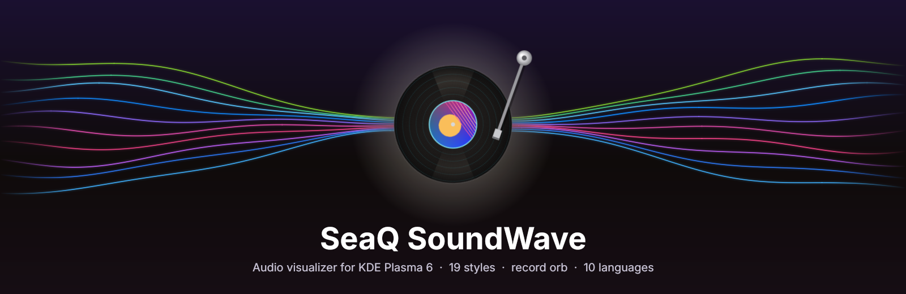

<br>

[](https://kde.org/plasma-desktop/)
[](CHANGELOG.md)
[](LICENSE)
[](#-languages)

**A beautiful audio visualizer for your KDE Plasma 6 desktop –<br>19 styles, flowing macOS colours and an orb (or a spinning record) that pauses your music and videos.**

**English** · [Deutsch](README.de.md)

<br>

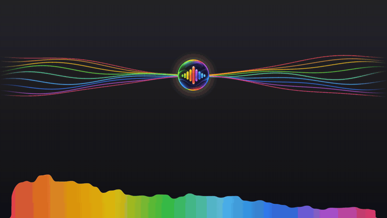

<sub>🎬 The full demo video with all styles: <a href="docs/soundwave-demo.mp4"><b>soundwave-demo.mp4</b></a></sub>

</div>

---

## 🆕 New in 2.5 – the record orb

<table>
<tr>
<td width="46%">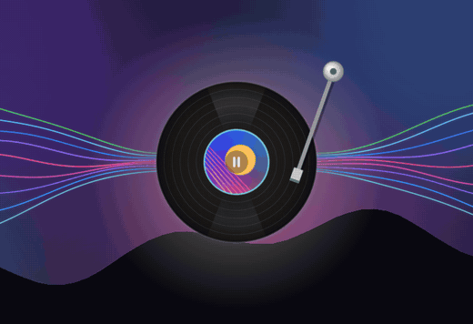</td>
<td>

### 💿 A turntable in the middle of your desktop

- **Spins with the music** – 33 rpm while something plays, stops exactly where it is on pause
- **Tone arm** swings onto the record when you press play and away when you pause
- **Cover on the label** – the cover of the song or video that is playing right now
- **Click it** to pause or resume music *and* video (YouTube, Spotify, VLC, Udemy …)
- Every part can be switched on or off: spinning, tone arm, cover

### 🔁 One switch for all styles

The orb is now set up **once for every style**: switch it on or off, pick its look or turn play/pause off – it applies to all styles at once. Only the size stays per style.

</td>
</tr>
</table>

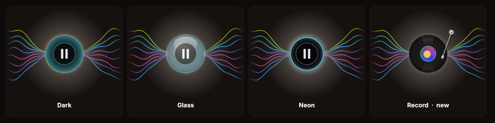

---

## ✨ Highlights

<table>
<tr>
<td width="33%" valign="top">

### 🎨 19 styles
Classic bars and waves, colourful **macOS** styles, **Lines & Light** that fill the whole screen, and **round** spectra.

</td>
<td width="33%" valign="top">

### 🔮 Orb & record
Effects flow out of an orb – or a spinning record. **Click to pause / resume** any player.

</td>
<td width="33%" valign="top">

### 🎵 Moves with the music
Width, wobble, line thickness, speed and the light in the middle all follow volume and bass.

</td>
</tr>
<tr>
<td valign="top">

### 📍 Place it anywhere
In the widget, **at a panel**, at **one of 9 fixed points** or **completely free** (<kbd>Meta</kbd>+<kbd>Alt</kbd>+<kbd>V</kbd>).

</td>
<td valign="top">

### 🌈 Colour collection
26 palettes plus a **gradient editor** for your own colours, with flowing colour animation.

</td>
<td valign="top">

### ⚙️ Settings that adapt
A clean editor in a System-Settings look – every style shows only the options it uses.

</td>
</tr>
<tr>
<td valign="top">

### 🌍 10 languages
English, Deutsch, Français, Español, Italiano, Nederlands, हिन्दी, 简体中文, 日本語, 한국어.

</td>
<td valign="top">

### 🛡️ Audio protection
Never leaves other apps muted – finds and repairs muted apps with one click.

</td>
<td valign="top">

### 🔒 Private & safe
Only listens on `127.0.0.1`, per-session token, nothing is recorded or sent anywhere.

</td>
</tr>
</table>

---

## 🖼️ All 19 styles

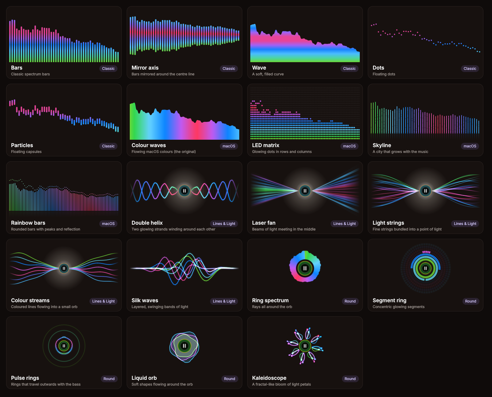

| Group | Styles | Good for |
|---|---|---|
| 🟦 **Classic** | Bars · Mirror axis · Wave · Dots · Particles | Inside the widget or on a panel |
| 🌈 **macOS** | Colour waves · LED matrix · Skyline · Rainbow bars | Lively rainbow look with flowing colours |
| ✨ **Lines & Light** | Double helix · Laser fan · Light strings · Colour streams · Silk waves | Wide areas, even the whole screen – with orb and light in the middle |
| ⭕ **Round** | Ring spectrum · Segment ring · Pulse rings · Liquid orb · Kaleidoscope | A play/pause circle in the middle |

---

## 🚀 Installation

### Option 1 – KDE Store *(easiest)*

Right click on the desktop → **Add Widgets…** → **Get New Widgets…** → search for **SeaQ SoundWave** → **Install**.

### Option 2 – The `.plasmoid` file from the [Releases](../../releases)

```sh
kpackagetool6 -t Plasma/Applet -i SeaQ-SoundWave-2.5.0.plasmoid   # install
kpackagetool6 -t Plasma/Applet -u SeaQ-SoundWave-2.5.0.plasmoid   # update
systemctl --user restart plasma-plasmashell                         # reload Plasma once
```

### Option 3 – From this repository

```sh
git clone https://github.com/SeaQSoft/SeaQ-SoundWave.git
cd SeaQ-SoundWave
sh install.sh            # install or update (also copies the translations)
sh install.sh --remove   # remove again
```

### Requirements

| Needed | Package (Fedora / Debian / Arch) | Why |
|---|---|---|
| `python3` | usually pre-installed | runs the small audio helper |
| `parec` **or** `pw-record` | `pulseaudio-utils` / `pipewire-utils` | captures what you hear |
| `cava` *(optional)* | `cava` | alternative analysis engine |
| `busctl` | pre-installed with systemd | lets the orb pause and resume players (MPRIS) |

---

## 🧭 How to use it

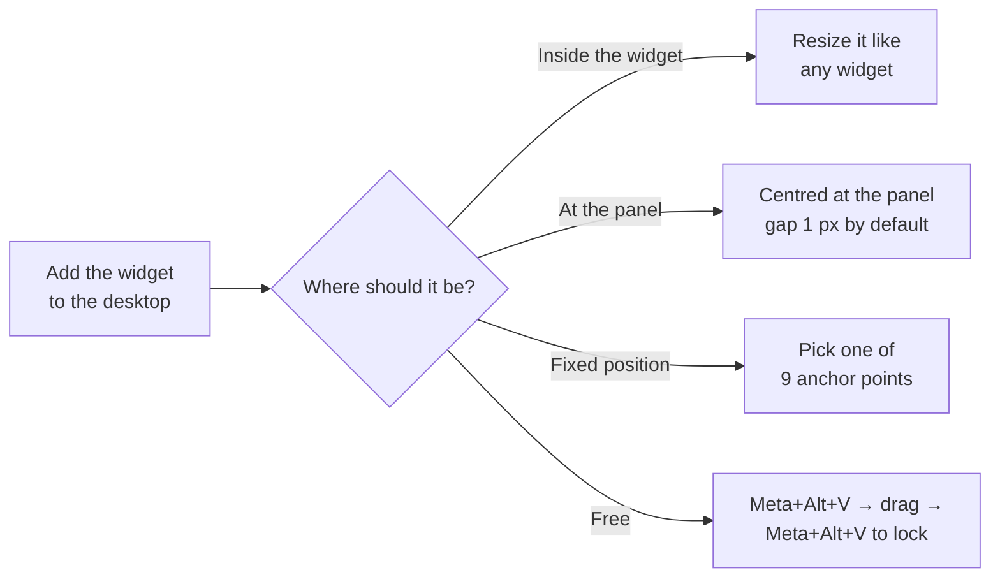

| What you do | What happens |
|---|---|
| 🖱️ **Click the orb / record** | Pauses everything that plays – click again to resume |
| 🖱️ **Right click the visualizer** | Opens a small pop-up card (preview, pause, lock, settings) – a click on an empty spot closes it |
| 🖱️ **Right click with the card switched off** | Opens the menu: settings editor, move freely, pause, configure |
| ⌨️ <kbd>Meta</kbd>+<kbd>Alt</kbd>+<kbd>V</kbd> | Unlocks free positioning – press again to lock |
| ↔️ **While unlocked** | Drag = move · edges/corners = resize · wheel = zoom · arrow keys = 1 px (<kbd>Shift</kbd> = 10 px) · <kbd>Enter</kbd> = lock |

---

## ⚙️ Settings

Right click → **Configure SeaQ SoundWave…** opens the **quick settings**. The big button there opens the **settings editor**:

<table>
<tr>
<td width="50%">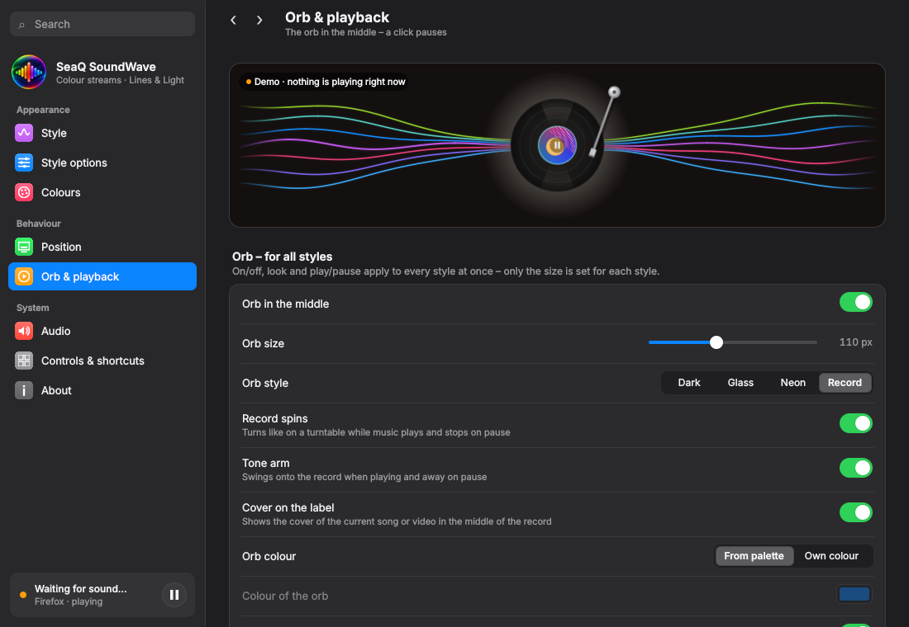<br><b>Orb & playback</b> – one orb for all styles, now with the record</td>
<td width="50%">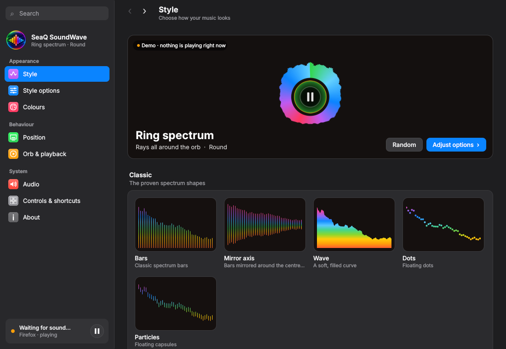<br><b>Style</b> – live previews of every style</td>
</tr>
<tr>
<td>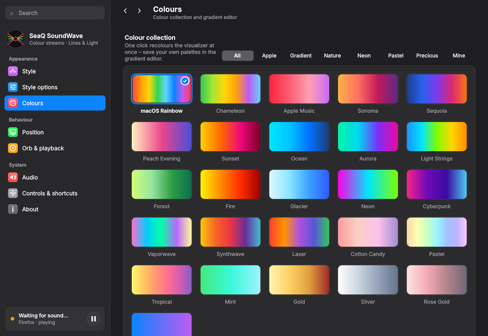<br><b>Colours</b> – collection, gradient editor, colour flow</td>
<td>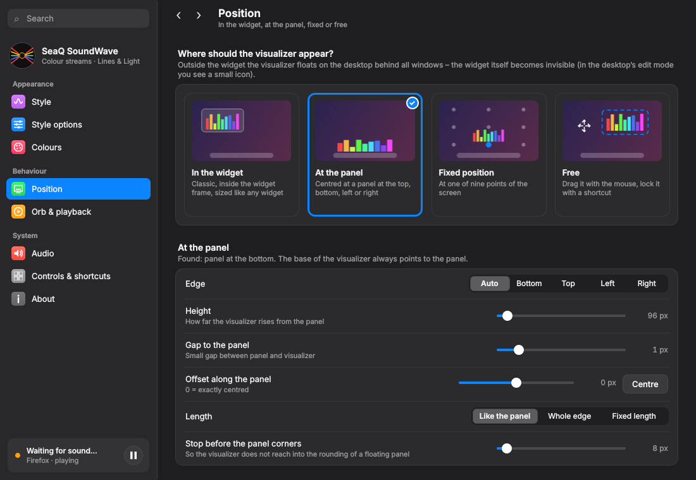<br><b>Position</b> – widget, panel, fixed or free</td>
</tr>
</table>

| Page | What you set there |
|---|---|
| 🟣 **Style** | Pick one of 19 styles (live previews) |
| 🔵 **Style options** | Lines, glow, light in the middle, spacing, peaks, reflection … – adapts to the style · background plate |
| 🔴 **Colours** | Colour collection · gradient editor · colour flow |
| 🟢 **Position** | Widget · panel (edge, height, gap, offset, length) · 9 anchor points · free · pop-up card on/off |
| 🟠 **Orb & playback** | On/off for all styles · dark / glass / neon / **record** · spinning, tone arm, cover · colour · play/pause |
| 🔴 **Audio** | Bands, sensitivity, frame rate, smoothing, engine, source · audio protection |
| ⚪ **Controls & shortcuts** | Global shortcut and a short guide |
| ⚪ **About** | Editor appearance, taskbar logo, support links and **factory reset** |

---

## 🌍 Languages

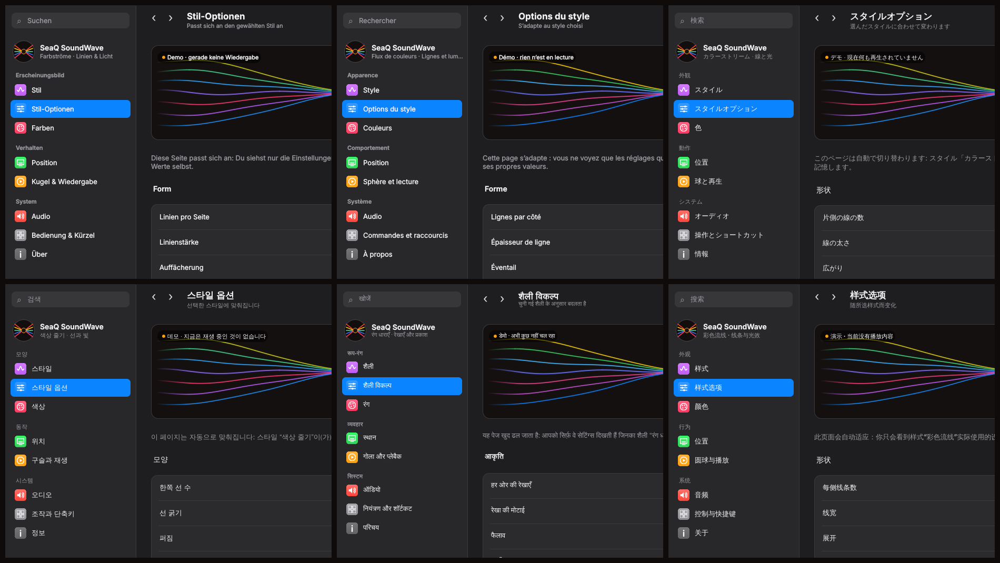

| | Language | | Language |
|---|---|---|---|
| 🇬🇧 | English *(default)* | 🇳🇱 | Nederlands |
| 🇩🇪 | Deutsch | 🇮🇳 | हिन्दी |
| 🇫🇷 | Français | 🇨🇳 | 简体中文 |
| 🇪🇸 | Español | 🇯🇵 | 日本語 |
| 🇮🇹 | Italiano | 🇰🇷 | 한국어 |

The widget follows the language of your Plasma session. **Add a language:** copy `po/seaq-soundwave.pot` to `po/<code>.po`, translate it, run `sh tools/build-translations.sh` and open a pull request. 🙌

---

## ❓ Troubleshooting

<details>
<summary><b>The visualizer does not move</b></summary>

Install `pulseaudio-utils` (provides `parec`) or `pipewire-utils` (provides `pw-record`) and restart Plasma. In **Audio → Source** keep `auto`. `pw-link -l | grep -i seaq` shows whether the recording stream is connected.
</details>

<details>
<summary><b>An app (e.g. YouTube in the browser) has no sound</b></summary>

Open **Audio → Audio protection** and click **Repair now**. SoundWave unmutes the app and removes the broken entry from WirePlumber's memory (backup: `~/.local/state/wireplumber/stream-properties.seaq-backup`).
</details>

<details>
<summary><b>Clicking the orb does nothing</b></summary>

The orb controls MPRIS players – most players and browsers support it. Check **Orb & playback → Clicking the orb** (*Pause / resume*) and that *Play/pause on click* is switched on.
</details>

<details>
<summary><b>The record shows no cover</b></summary>

The cover comes from the player (`mpris:artUrl`). Some players and websites don't send one – then the label shows the palette colours.
</details>

<details>
<summary><b>Panel, fixed and free placement are greyed out</b></summary>

These modes need the widget on the **desktop** (not inside a panel).
</details>

---

## 🗂️ Project structure

```
SeaQ-SoundWave/
├── metadata.json            widget metadata (id: com.seaq.soundwave)
├── contents/
│   ├── config/              settings schema + quick settings page
│   ├── icons/               app icon
│   ├── locale/              compiled translations (.mo)
│   ├── scripts/             audio-server.py – audio analysis + media control
│   └── ui/                  QML: main.qml, Visualizer, Orb, editor/, js/ (styles, renderers, palettes)
├── po/                      translation sources (.pot / .po)
├── tools/                   build-translations.sh, package.sh
├── docs/                    screenshots, demo video + KDE Store text
└── install.sh
```

---

## 🔒 Privacy & security

- The audio helper only listens on `127.0.0.1` and accepts requests **only from this widget** (random per-session token + `Host` check).
- SoundWave only **reads** what you hear – nothing is recorded to disk or sent anywhere.
- The record's cover is loaded from the address the player itself provides (a local file or the player's web address). Switch it off with **Cover on the label**.
- Its own recording stream is never remembered by WirePlumber, so it can't leave other apps muted.
- Optional taskbar logo (switch in *About*): a hidden desktop file + KWin rule – switching it off removes both.

---

## ☕ Support

If you like SeaQ SoundWave, you can support its development – thank you! ♥

<p align="center">
<a href="https://paypal.me/SeaQSoft"></a>
<a href="https://buymeacoffee.com/seaq"></a>
</p>

---

<div align="center">

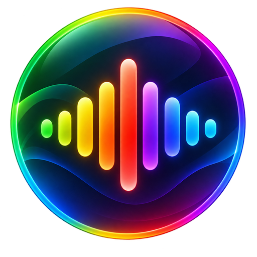

**GPL-3.0-or-later** © 2026 SeaQ – see [LICENSE](LICENSE) · [Changelog](CHANGELOG.md)

Made with ♥ for KDE Plasma by <a href="https://github.com/SeaQSoft">SeaQ</a>

</div>
